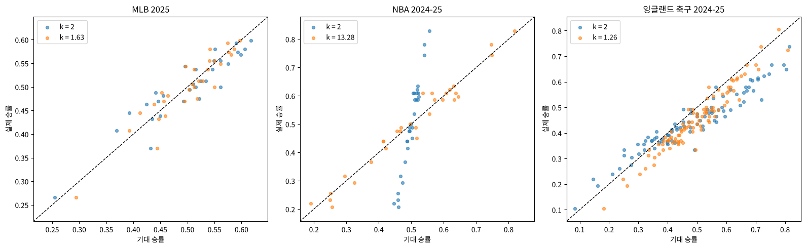

# 🏟️ Sports Analytics: 피타고라스 기대 승률 2025 재검증

**강의에서 배운 피타고라스 기대 승률 분석을 2025 시즌 MLB·NBA·잉글랜드 축구 데이터에 직접 적용하고, 종목별 최적 지수와 '후반기 예측력'을 새 데이터로 다시 검증한 프로젝트**

> **English summary** — After taking *Foundations of Sports Analytics* (University of Michigan, Coursera), I applied the Pythagorean expectation to 2025-season data I collected myself: MLB 2025 (2,430 games), NBA 2024-25 (30 teams), and English football tiers 1–4 in 2024-25 (2,036 games). I then went beyond the course by (1) fitting the best exponent per sport (MLB 1.63, NBA 13.3, football 1.26; using k = 2 for the NBA misses by ~11 wins vs ~2.5 with the fitted exponent) and (2) re-testing the course's claim that first-half Pythagorean expectation predicts second-half win percentage better than first-half win percentage. With 2025 data the claim did not hold consistently: it failed for MLB 2025 and the Premier League but held for the lower English divisions.


*지수 2(파랑)와 데이터로 찾은 최적 지수(주황)의 기대 승률 vs 실제 승률. NBA는 지수 2를 쓰면 기대 승률이 0.5 근처에 몰려 실제와 크게 어긋난다.*

## 피타고라스 기대 승률이란

$$\text{기대 승률} = \frac{\text{득점}^k}{\text{득점}^k + \text{실점}^k}$$

득점과 실점만으로 팀의 '실력에 맞는' 승률을 추정하는 공식입니다. 접전에서 운 좋게 이긴 경기가 많으면 실제 승률이 기대 승률보다 높게 나오기 때문에, 팀의 실제 실력을 보는 지표로 쓰입니다. 야구 통계가 빌 제임스가 처음 제안했습니다.

## 노트북 구성

| 노트북 | 내용 |
|---|---|
| `01_mlb_2025` | MLB 2025 정규시즌 2,430경기 → 팀별 득실점·승률 → 기대 승률(k=2)과 회귀분석 |
| `02_nba_2025` | NBA 2024-25 30개 팀에 같은 분석 |
| `03_england_football_2024_25` | 잉글랜드 1~4부 2,036경기, 승점(승 3·무 1) 기준, 리그별 비교 |
| `04_optimal_exponent` | **추가 분석**: 종목마다 가장 잘 맞는 지수 k를 데이터로 찾기 |
| `05_half_season_prediction_2025` | **추가 분석**: 전반기 기대 승률이 후반기 승률을 더 잘 예측하는지 2025 데이터로 재검증 |

01~03은 강의 방법을 직접 구한 2025 데이터에 적용한 것이고, 04~05는 강의에 없던 분석입니다.

## 결과

### 1. 기대 승률은 세 종목 모두에서 실제 승률을 잘 설명한다 (01~03)

| 리그 | R² (k = 2) |
|---|---|
| MLB 2025 | 0.857 |
| NBA 2024-25 | 0.964 |
| 잉글랜드 1~4부 2024-25 | 0.924 |

### 2. 종목마다 맞는 지수가 다르다 (04)

| 리그 | 최적 지수 k | 오차 (k = 2) | 오차 (최적 k) |
|---|---|---|---|
| MLB 2025 | 1.63 | 4.9승 | 4.3승 |
| NBA 2024-25 | **13.28** | **11.1승** | **2.5승** |
| 잉글랜드 축구 | 1.26 | 3.5경기 | 2.5경기 |

득점이 많은 농구는 득실점 차이가 비율로는 작아서 큰 지수가 필요합니다. 01~03의 R²는 k = 2로도 높게 나왔지만, 이는 순위 관계가 맞았다는 뜻이고 기대 승률 **값 자체**는 NBA에서 시즌 11승이나 틀렸습니다. 알려진 값(야구 약 1.83, 농구 약 14 내외)과 같은 방향입니다.

### 3. "기대 승률이 미래를 더 잘 예측한다"는 2025 데이터에서 일관되게 나타나지 않았다 (05)

강의는 2018 MLB에서 전반기 기대 승률(상관 0.691)이 전반기 승률(0.653)보다 후반기 승률을 조금 더 잘 예측한다고 보였습니다. 같은 검증을 2025 데이터로 했습니다 (기대 승률의 지수는 전반기 데이터만으로 추정).

| 리그 | 전반기 승률 | 전반기 기대 승률 | 기대 승률이 나을 확률 (부트스트랩) |
|---|---|---|---|
| MLB 2025 | **0.454** | 0.423 | 35% |
| 프리미어리그 | **0.724** | 0.659 | 25% |
| 챔피언십 (2부) | 0.593 | **0.685** | 95% |
| 리그1 (3부) | 0.532 | **0.599** | 92% |
| 리그2 (4부) | 0.237 | **0.288** | 73% |
| 잉글랜드 1~4부 전체 | 0.557 | **0.578** | 72% |

값은 후반기 승률과의 상관계수입니다. MLB 2025와 프리미어리그에서는 오히려 전반기 승률이 더 나았고, 잉글랜드 하위 리그에서는 기대 승률이 더 나았습니다. 팀 수가 20~30개라 상관계수 0.03 정도의 차이는 표본에 따라 뒤집힐 수 있어서, **한 시즌 결과만으로 일반화하기 어렵다**는 것을 직접 확인했습니다.

## 이 프로젝트로 알게 된 것

- **높은 R²가 '잘 맞는다'는 뜻은 아니다.** NBA는 R² 0.964였지만 기대 승률 값은 시즌 11승이나 틀렸다. 상관과 오차는 따로 봐야 한다.
- **강의의 결론도 데이터가 바뀌면 다시 확인해야 한다.** 2018년 데이터의 결론이 2025년에는 리그에 따라 반대로 나왔다.
- **표본이 작으면 차이를 확신하기 어렵다.** 부트스트랩으로 같은 결과가 얼마나 흔들리는지 보는 습관이 중요하다.

## 실행 방법

```bash
pip install pandas numpy scipy statsmodels seaborn matplotlib openpyxl
cd notebooks
jupyter notebook
```

## 데이터 출처

- MLB 2025: Shane McDonald, MLB 2025 As-Played Schedule ([shanemcd.org](https://shanemcd.org))
- 잉글랜드 축구 2024-25: [football-data.co.uk](https://www.football-data.co.uk) (E0~E3)
- NBA 2024-25: 정규시즌 팀별 승수·득점·실점 직접 정리

## 참고

- 방법: University of Michigan, *Foundations of Sports Analytics: Data, Representation, and Models in Sports* (Coursera) 1주차
- 강의 자료 원본 노트북과 과제 답안은 이 레포에 포함하지 않았습니다.
